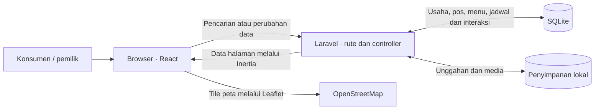

# NEARASA

**Temukan kuliner lokal sesuai jarak, jam, dan anggaran.**  
*Good food is closer than you think.*

NEARASA membantu pelanggan menemukan warung dan pedagang kuliner yang berjualan di lokasi tetap atau beberapa pos rutin. Pelanggan bisa mengecek menu, harga, lokasi, dan jam sebelum berangkat. Pemilik mengelola informasi usaha dan menyesuaikan kondisi masing-masing pos.

**Tim** · bismillah alhamdulillah  
**Anggota** · Firzan Syaroni, Cleo Firman Ferdinand, dan Gani Abi Saputra Van Sigu  
**Kategori** · Web App Development, subtema UMKM dan pemberdayaan ekonomi

> **Arsip prototipe tim.** NEARASA mulai dikembangkan sebelum Hacking Week LOGICODIX. Repositori ini mendokumentasikan fitur prototipe dan cara mencobanya secara lokal.

## Masalah dan pengguna

Sejumlah warung yang diamati tim sulit ditemukan secara online. Pelanggan juga perlu mengetahui lokasi yang tepat, waktu penjual berada di sana, serta harga makanan. Pengamatan dan percakapan informal dengan pedagang menjadi dasar rancangan. Sidoarjo dan Surabaya dipilih sebagai wilayah awal untuk menguji kebutuhan tersebut.

- **Konsumen** dapat membandingkan pilihan kuliner berdasarkan jarak, anggaran, dan jadwal pos.
- **Pemilik UMKM** menggunakan satu profil untuk menu dan harga bersama. Lokasi, jadwal, ulasan, dan ketersediaan menu dapat berbeda di tiap pos.

## Fitur yang bisa dicoba

| Bagian | Kemampuan prototipe |
| --- | --- |
| Jelajah dan Peta | Pencarian nama/menu, filter kategori/harga, titik pencarian GPS atau manual, radius, serta hasil dan pin per pos. Jarak memakai garis lurus. |
| Profil usaha | Menu, harga, stok, lokasi, jam, ulasan, foto, dan Kabar usaha. Peta memilih pos yang sama dari halaman detail. Kontak WhatsApp tersedia jika pemilik mengisinya. |
| Akun | Masuk dengan akun yang tersedia, pengaturan nama publik, Favorit per usaha, Riwayat per pos, dan rekomendasi kategori sederhana berdasarkan aktivitas serta favorit di NEARASA. |
| Pengelolaan UMKM | Dashboard seluruh usaha milik akun, editor profil/menu/pos, jadwal rutin dan jam khusus hari ini, serta status tersedia/habis per pos. |
| Interaksi dan laporan | Pelanggan login dapat memberi ulasan atau melaporkan pos ditemukan tutup. Pemilik dapat memeriksa laporan dan melihat jumlah buka profil, buka menu, klik peta, dan klik WhatsApp. |

Katalog awal berisi usaha dan menu fiktif. Dashboard menghitung interaksi di aplikasi. Alur yang dapat dicoba berakhir saat pengguna membuka detail pos, peta, atau kontak penjual.

Rencana lanjutan mencakup pendaftaran usaha baru, masuk dengan Google, kontribusi galeri pengunjung, interaksi sosial pada Kabar, dan panel admin.

## Teknologi dan arsitektur

- **Backend** · Laravel 13, sesi dan validasi Laravel, serta SQLite.
- **Frontend** · React, TypeScript, dan Inertia. Vite membangun aset. Tampilan memakai CSS, Tailwind CSS, dan ikon Lucide.
- **Peta** · Leaflet dengan tile OpenStreetMap secara bawaan. Katalog dan koordinat pos berasal dari database NEARASA. Aplikasi tetap menyediakan daftar hasil saat tile peta sedang tidak tersedia.



Perubahan menu, jam, atau stok disimpan lewat Laravel. Halaman publik membaca perubahan tersebut dari database saat data halaman dimuat. Pos terpilih menentukan jadwal, ketersediaan, dan ulasan yang ditampilkan.

## Struktur proyek

```text
nearasa/
├── app/                 Controller, model, dan layanan Laravel
├── database/            Migrasi SQLite dan seeder data demo
├── resources/
│   ├── css/             Gaya antarmuka
│   └── js/              Halaman Inertia dan komponen React
├── routes/web.php       Rute konsumen, akun, dan pemilik
└── tests/               Tes backend dan frontend
```

Alur konsumen dimulai dari Beranda, Jelajah, atau Peta. Setelah masuk, pemilik bisa membuka dashboard di `/kelola-usaha`. [Daftar rute](routes/web.php) · [Glosarium usaha dan pos](CONTEXT.md)

## Menjalankan dari checkout baru

Siapkan **PHP 8.4.1 atau lebih baru pada seri 8.x** dengan ekstensi Laravel dan `pdo_sqlite`, **Composer**, serta **Node.js 22.13 atau lebih baru**. Jalankan dari direktori yang berisi `artisan`.

```sh
composer install
php -r "file_exists('.env') || copy('.env.example', '.env');"
php -r "file_exists('database/database.sqlite') || touch('database/database.sqlite');"
php artisan key:generate
php artisan migrate --seed
npm ci
npm run build
php artisan serve --host=127.0.0.1 --port=8787
```

Buka [NEARASA lokal](http://127.0.0.1:8787/). Langkah di atas ditujukan untuk checkout dan database baru. Seeder katalog mengisi atau menyegarkan usaha contoh. Jika mengembangkan frontend, jalankan `npm run dev` bersama server Laravel.

Di PowerShell, `npm.cmd` dapat dipakai untuk menjalankan npm. Lingkungan Laragon yang sudah disiapkan dapat memakai [scripts/php.ps1](scripts/php.ps1) untuk perintah Artisan dan `.\scripts\dev.ps1 -Port 8787` untuk menyalakan server. Atur `NEARASA_PHP` bila lokasi `php.exe` berbeda.

### Konfigurasi

Salin konfigurasi awal dari [.env.example](.env.example). Gunakan `.env` di lingkungan masing-masing.

| Variabel | Penggunaan |
| --- | --- |
| `APP_ENV`, `APP_DEBUG`, `APP_URL` | Lingkungan Laravel, mode debug, dan alamat dasar. Contoh lokal memakai `http://127.0.0.1:8787`. |
| `APP_KEY` | Dibuat dengan `php artisan key:generate`. |
| `DB_CONNECTION`, `DB_DATABASE` | Gunakan `sqlite`. Path bawaan adalah `database/database.sqlite`; isi `DB_DATABASE` untuk file lain. |
| `NEARASA_DEMO_AUTH` | Bawaan `false`. Aktifkan untuk tombol akun UMKM di lingkungan `local`. |
| `MAP_TILE_URL` | Opsional. Alamat template tile `{z}/{x}/{y}` pada [konfigurasi peta](config/nearasa.php). |

### Mencoba sebagai pemilik UMKM

1. Pada lingkungan lokal, set `NEARASA_DEMO_AUTH=true` di `.env`.
2. Jalankan `php artisan db:seed --class=DemoAccountSeeder` setelah seeder katalog.
3. Buka [Masuk](http://127.0.0.1:8787/masuk), tekan **Coba akun UMKM**, lalu pilih **Kelola usaha**. Akun fiktif memiliki Dapur Griya dan Pizza Sore.
4. Pilih satu pos dan ubah jam atau ketersediaan menu. Buka profil publik untuk melihat hasilnya.

Tombol demo memakai sesi lokal. Login biasa menerima akun yang telah tersedia di database lingkungan tersebut. Prototipe ini menyediakan instruksi demonstrasi lokal dan data seed.

## Pengujian

```sh
php artisan test --compact
npm run typecheck
npm run test:discovery
npm run test:profile
npm run test:consumer
npm run build
```

Tes backend memakai database SQLite sementara di memori. Tes frontend memeriksa perilaku pencarian dan peta, profil usaha, serta halaman konsumen.

## Penggunaan AI dan atribusi

| Sumber | Bagian yang menggunakan |
| --- | --- |
| OpenAI Codex | Bantuan perancangan, implementasi, pengujian, dan dokumentasi prototipe. |
| OpenAI Imagegen | [Ilustrasi kuliner Beranda dan Masuk](public/images/brand/SOURCES.md) serta [ilustrasi sampul usaha fiktif](public/images/demo/places/SOURCES.md). |
| Unsplash | [Foto ilustrasi makanan katalog](public/images/demo/SOURCES.md). |
| Laravel, Inertia, React, Vite, Tailwind CSS, Leaflet, dan Lucide | Struktur awal dan dependensi aplikasi tercatat di [composer.json](composer.json) serta [package.json](package.json), dengan versi terkunci pada lockfile. |
| OpenStreetMap | Peta dasar yang dimuat di browser. [Atribusi kontributor OpenStreetMap](https://www.openstreetmap.org/copyright) |
| Data demo NEARASA | Usaha, lokasi contoh, menu, dan jadwal untuk demonstrasi. [CatalogSeeder](database/seeders/CatalogSeeder.php) |

Saat aplikasi berjalan, rekomendasi dihitung dari kategori usaha yang berhubungan dengan interaksi dan favorit pengguna. [InteractionTracker](app/Services/InteractionTracker.php)
