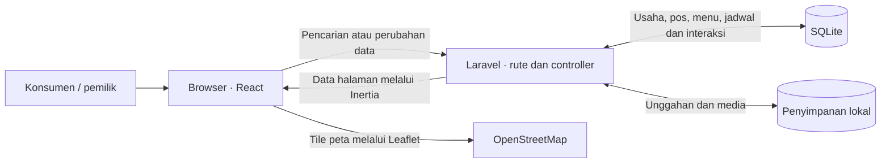

# NEARASA

**Temukan Kuliner dengan Lebih Pasti.**

NEARASA membantu pelanggan menemukan warung dan pedagang kuliner yang berjualan di lokasi tetap atau beberapa pos rutin. Pelanggan bisa mengecek menu, harga, lokasi, dan jam sebelum berangkat. Pemilik mengelola informasi usaha dan menyesuaikan kondisi masing-masing pos.

**Tim** · bismillah alhamdulillah  
**Anggota** · Firzan Syaroni, Cleo Firman Ferdinand, dan Gani Abi Saputra Van Sigu  
**Kategori** · Web App Development, subtema Local MSME & Creative Economy

> **Arsip prototipe tim.** Pengembangan NEARASA dimulai sebelum Hacking Week LOGICODIX. [Commit arsip awal](https://github.com/KurioSannn/NEARASA/commit/8b12f8f9779a7c1d19166705c95f65af094876bc)

[Jalankan lokal](#menjalankan-dari-checkout-baru) · [Alur demo](#alur-demo) · [Fitur](#fitur-yang-bisa-dicoba) · [Dokumentasi teknis](dokumentasi/info.md)

## Masalah dan pengguna

Sejumlah warung yang diamati tim sulit ditemukan secara online. Pelanggan juga perlu mengetahui lokasi yang tepat, waktu penjual berada di sana, serta harga makanan. Pengamatan dan percakapan informal dengan pedagang menjadi dasar rancangan. Sidoarjo dan Surabaya dipilih sebagai wilayah awal untuk menguji kebutuhan tersebut.

- **Konsumen** dapat membandingkan pilihan kuliner berdasarkan jarak, anggaran, dan jadwal pos.
- **Pemilik UMKM** memperbarui informasi jualan dan melihat interaksi pelanggan untuk usaha miliknya.

Satu akun pemilik dapat mengelola beberapa usaha. Setiap usaha memiliki satu profil serta daftar menu dan harga yang dipakai bersama oleh semua pos jualannya. Tiap pos memiliki titik, jadwal, ketersediaan menu, dan ulasan sendiri. [Glosarium usaha dan pos](CONTEXT.md)

## Fitur yang bisa dicoba

| Bagian | Halaman | Kemampuan prototipe |
| --- | --- | --- |
| Beranda | `/` | Pencarian cepat, pilihan usaha, kategori menu, dan cuplikan peta. Rekomendasi personal tampil jika aktivitas akun memberi data yang cukup. |
| Jelajah dan Peta | `/jelajah`, `/peta` | Cari nama usaha atau menu, filter jenis, kategori, harga, dan radius. Pilih titik pencarian dengan GPS atau secara manual. Hasil dan pin mengikuti pos jualan. |
| Profil publik | `/usaha/{slug}`, `/pemilik/{id}` | Lihat menu, harga, stok, lokasi, jadwal, dan ulasan untuk pos yang dipilih. Foto, Kabar, dan kontak WhatsApp tampil sesuai informasi yang tersedia. Profil pemilik menampilkan usaha yang sudah terbit. |
| Masuk dan akun | `/masuk`, `/akun` | Masuk dengan email dan sandi untuk akun yang tersedia. Akun masuk dapat mengubah nama lengkap, nama publik, foto profil, dan kata sandi. |
| Favorit, riwayat, dan komunitas | `/favorit`, `/riwayat`, profil usaha | Akun masuk dapat menyimpan usaha, melihat aktivitas per pos, serta memberi ulasan per pos dengan foto opsional. |
| Daftar usaha | `/kelola-usaha/daftar` | Akun yang sudah masuk dapat mendaftarkan usaha dan pos pertama beserta jadwalnya. |
| Dashboard pemilik | `/kelola-usaha`, `/kelola-usaha/ulasan` | Lihat ringkasan usaha milik akun, jumlah buka profil, buka menu, klik peta, dan klik WhatsApp. Pemilik dapat membaca ulasan pelanggan dan memfilternya berdasarkan usaha. |
| Editor usaha | `/kelola-usaha/pengaturan`, `/kelola-usaha/{slug}` | Pilih usaha dan pos, lalu atur jam hari ini, status tersedia atau habis, harga, jadwal rutin, profil, foto, dan Kabar. |
| NEARASA Awards | `/awards` | Simulasi peringkat usaha berdasarkan interaksi contoh, dengan pilihan mingguan, bulanan, tahunan, Sidoarjo, dan Surabaya. |
| Asisten pencarian | Halaman konsumen | Mencari menu tersedia di katalog berdasarkan kata kunci, area, dan anggaran. Server mengurutkan hasil memakai jarak, rating per pos, dan kunjungan profil 7 hari terakhir. Gemini opsional untuk memahami maksud pencarian. |

Jarak dihitung sebagai **garis lurus** dari titik pencarian ke pos. Setelah memilih titik, radius bawaan adalah 5 km dan tersedia pilihan **Tanpa batas**. Titik pencarian tersimpan di sesi. Filter seperti kata kunci, harga, dan radius dapat dibagikan melalui URL, misalnya `/jelajah?q=ayam&max_price=25000`. [Daftar rute](routes/web.php)

Katalog awal berisi usaha dan menu fiktif. Jam buka mengikuti jadwal dan perubahan yang dicatat pemilik. Dashboard menghitung buka profil, buka menu, klik peta, dan klik WhatsApp. Rekomendasi menggunakan kategori yang berkaitan dengan aktivitas dan favorit akun. Awards memakai kejadian sintetis untuk menunjukkan cara penghitungan peringkat. [Katalog demo](database/seeders/CatalogSeeder.php) · [Data Awards](database/seeders/AwardsDemoSeeder.php) · [Logika rekomendasi](app/Services/InteractionTracker.php)

## Teknologi dan arsitektur

- **Backend** · Laravel 13, sesi dan validasi Laravel, serta SQLite.
- **Frontend** · React, TypeScript, dan Inertia. Vite membangun aset. Tampilan memakai CSS, Tailwind CSS, dan ikon Lucide.
- **Peta** · Leaflet dengan tile OpenStreetMap secara bawaan. Katalog dan koordinat pos berasal dari database NEARASA. Halaman Peta menyediakan tautan ke daftar Jelajah jika peta dasar gagal dimuat.



Perubahan menu, jam, atau stok disimpan lewat Laravel. Halaman publik membaca perubahan tersebut dari database saat data halaman dimuat. Pos terpilih menentukan jadwal, ketersediaan, dan ulasan yang ditampilkan.

## Struktur proyek

```text
nearasa/
├── app/                 Controller, model, dan layanan Laravel
├── database/            Migrasi SQLite dan seeder data demo
├── resources/
│   ├── css/             Gaya antarmuka
│   └── js/              Halaman Inertia, tata letak, dan komponen React
├── public/images/       Ilustrasi, foto katalog demo, dan aset merek
├── dokumentasi/         Panduan deployment dan catatan teknis
├── routes/web.php       Rute konsumen, akun, dan pemilik
├── scripts/             Perintah PHP dan server lokal untuk Windows
└── tests/               Tes backend dan frontend
```

## Menjalankan dari checkout baru

Siapkan **PHP 8.4.1 atau lebih baru pada seri 8.x** dengan ekstensi Laravel dan `pdo_sqlite`, **Composer**, serta **Node.js 22.13 atau lebih baru**. Gunakan akun GitHub yang punya akses ke repo dan jalankan perintah dari direktori yang berisi `artisan`.

```sh
git clone https://github.com/KurioSannn/NEARASA.git
cd NEARASA

composer install
php -r "file_exists('.env') || copy('.env.example', '.env');"
php -r "file_exists('database/database.sqlite') || touch('database/database.sqlite');"
php artisan key:generate
php artisan migrate --seed
npm ci
npm run build
php artisan serve --host=127.0.0.1 --port=8787
```

Setup di atas mengisi database demo baru. Gunakan `php artisan migrate` untuk database yang sudah dipakai agar perubahan profil, menu, dan pos tetap tersedia. Jalankan kembali `npm ci` dan `npm run build` setelah mengambil pembaruan frontend. Untuk pengembangan, jalankan `npm run dev` di terminal lain bersama server Laravel. [Buka NEARASA lokal](http://127.0.0.1:8787/)

Di PowerShell, `npm.cmd` dapat dipakai untuk menjalankan npm. Lingkungan Laragon yang sudah disiapkan dapat memakai [scripts/php.ps1](scripts/php.ps1) untuk perintah Artisan dan `.\scripts\dev.ps1 -Port 8787` untuk menyalakan server. Atur `NEARASA_PHP` bila lokasi `php.exe` berbeda.

### Konfigurasi

Salin konfigurasi awal dari [.env.example](.env.example). Gunakan `.env` di lingkungan masing-masing.

| Variabel | Penggunaan |
| --- | --- |
| `APP_ENV`, `APP_DEBUG`, `APP_URL` | Lingkungan Laravel, mode debug, dan alamat dasar. Contoh lokal memakai `http://127.0.0.1:8787`. |
| `APP_KEY` | Dibuat dengan `php artisan key:generate`. |
| `DB_CONNECTION`, `DB_DATABASE` | Gunakan `sqlite`. Path bawaan adalah `database/database.sqlite`; isi `DB_DATABASE` untuk file lain. |
| `NEARASA_DEMO_AUTH` | Bawaan `false`. Aktifkan untuk tombol akun UMKM di lingkungan `local`. |
| `GEMINI_API_KEY`, `GEMINI_MODEL` | Opsional. Isi kunci di `.env` server untuk mengirim teks pertanyaan ke Gemini. Model bawaan `gemini-3.5-flash-lite`. Tanpa kunci atau saat API gagal, asisten memakai pencarian katalog. |
| `MAP_TILE_URL` | Opsional. Alamat template tile `{z}/{x}/{y}` yang dimuat browser. [Konfigurasi peta](config/nearasa.php) |
| `DB_URL`, `ASSET_URL`, `SESSION_SECURE_COOKIE` | Pengaturan database, aset HTTPS, dan cookie untuk lingkungan online. [Panduan deployment](dokumentasi/deployment-demo.md) |

## Alur demo

### Mencari kuliner sebagai konsumen

1. Buka **Jelajah**. Cari nama usaha atau menu dan coba batas harga Rp25.000.
2. Pilih titik pencarian, lalu sesuaikan radius. Bandingkan hasil daftar dengan pos yang muncul di **Peta**.
3. Buka salah satu usaha dan ganti pos yang dipilih. Periksa jam, ulasan, dan ketersediaan menu untuk pos tersebut.

### Mengelola usaha sebagai pemilik UMKM

1. Pada lingkungan lokal, set `APP_ENV=local` dan `NEARASA_DEMO_AUTH=true` di `.env`.
2. Jalankan `php artisan db:seed --class=DemoAccountSeeder` setelah seeder katalog.
3. Pilih **Coba akun UMKM** di halaman masuk untuk membuka dashboard pemilik Dapur Griya dan Pizza Sore. [Buka halaman masuk](http://127.0.0.1:8787/masuk)
4. Di **Kelola usaha**, pilih **Dapur Griya** dan salah satu pos. Pada tab **Operasional**, tandai satu menu habis.
5. Pilih **Lihat publik** dan cek menu di pos yang sama. Bandingkan dengan pos lain untuk melihat ketersediaan masing-masing. Gunakan **Pos & jadwal** atau **Menu & harga** untuk pengaturan berikutnya.

Jika tombol demo belum tampil, periksa `APP_ENV`, `NEARASA_DEMO_AUTH`, dan hasil seeder. Jika Laravel menampilkan `could not find driver`, aktifkan `pdo_sqlite` pada PHP yang dipakai terminal. Jika manifest Vite belum tersedia, jalankan `npm ci` dan `npm run build`.

### Awards dan demo online

- Isi data Awards dengan `php artisan db:seed --class=AwardsDemoSeeder`, lalu buka **Awards** dan pilih wilayah serta periode.
- Untuk akun demo online, administrator menyiapkan katalog khusus demo dan membuat akun pemilik lewat perintah Artisan yang meminta sandi melalui terminal. Juri masuk melalui formulir email dan sandi. [Menyiapkan demo online](dokumentasi/deployment-demo.md)

## Pengujian

```sh
php artisan test --compact
npm run typecheck
npm run test:discovery
npm run test:profile
npm run test:consumer
npm run build
```

Tes backend memakai database SQLite sementara di memori. Tes frontend memeriksa perilaku pencarian dan peta, profil usaha, serta halaman konsumen. Di PowerShell dengan Laragon, jalankan tes backend melalui `.\scripts\php.ps1 artisan test --compact`.

Jalankan pengujian pada checkout yang dipakai untuk demo dan catat hash commit yang diuji. Periksa juga alur pemilik dan konsumen pada katalog baru dengan skenario di atas.

## Roadmap

| Tahap | Fokus pekerjaan | Hasil yang bisa diperiksa |
| --- | --- | --- |
| Demo tim | Coba checkout baru, login, pencarian, perubahan stok per pos, serta akses online dan localhost. | Anggota tim lain bisa menjalankan alur tanpa bantuan pengembang. |
| Uji pengguna | Libatkan konsumen dan UMKM di Sidoarjo dan Surabaya untuk mencoba pencarian dan pembaruan usaha. | Tim mendapat temuan penggunaan dan prioritas perbaikan. |
| Onboarding | Uji alur daftar usaha dengan pemilik baru dan pertimbangkan masuk dengan Google. | Pemilik dapat menerbitkan profil dan pos pertama, lalu menambahkan menu di Kelola Usaha. |
| Komunitas | Kontribusi foto pengunjung, moderasi, dan interaksi pada Kabar. | Foto dan laporan terhubung dengan pos dan ditangani oleh peran yang sesuai. |

## Penggunaan AI dan atribusi

| Sumber | Bagian yang menggunakan |
| --- | --- |
| OpenAI Codex | Bantuan perancangan, implementasi, pengujian, dan dokumentasi prototipe. |
| OpenAI Imagegen | [Ilustrasi kuliner Beranda dan Masuk](public/images/brand/SOURCES.md) serta [ilustrasi sampul usaha fiktif](public/images/demo/places/SOURCES.md). |
| Unsplash | [Foto ilustrasi makanan katalog](public/images/demo/SOURCES.md). |
| Laravel, Inertia, React, Vite, Tailwind CSS, Leaflet, dan Lucide | Struktur awal dan dependensi aplikasi tercatat di [composer.json](composer.json) serta [package.json](package.json), dengan versi terkunci pada lockfile. |
| OpenStreetMap | Peta dasar yang dimuat di browser. [Atribusi kontributor](https://www.openstreetmap.org/copyright) · [Kebijakan tile](https://operations.osmfoundation.org/policies/tiles/) |
| Data demo NEARASA | Usaha, lokasi contoh, menu, dan jadwal untuk demonstrasi. [CatalogSeeder](database/seeders/CatalogSeeder.php) |
