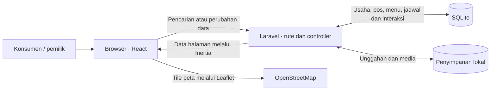
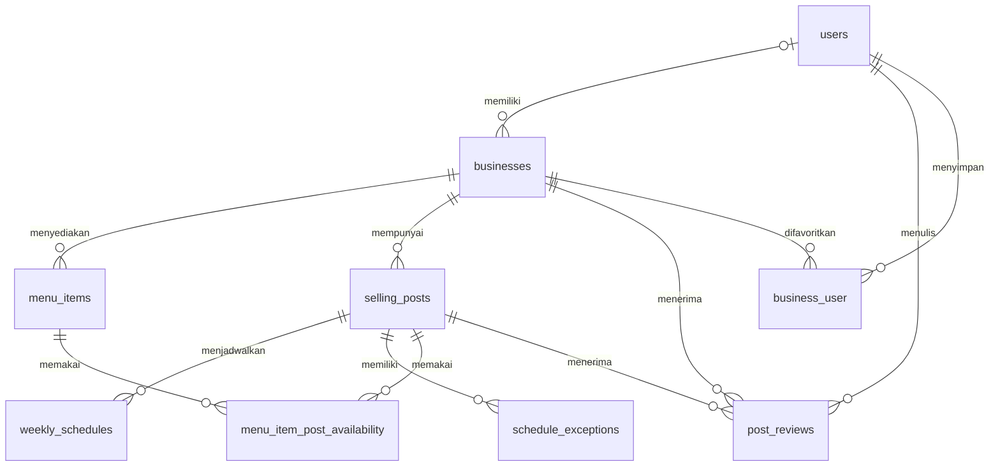

# NEARASA

**Temukan Kuliner dengan Lebih Pasti.**

NEARASA membantu pelanggan menemukan warung dan pedagang kuliner yang berjualan di lokasi tetap atau beberapa pos rutin. Pelanggan bisa mengecek menu, harga, lokasi, dan jam sebelum berangkat. Pemilik mengelola informasi usaha dan menyesuaikan kondisi masing-masing pos.

**Tim** · bismillah alhamdulillah  
**Anggota** · Firzan Syaroni, Cleo Firman Ferdinand, dan Gani Abi Saputra Van Sigu  
**Kategori** · Web App Development, subtema Local MSME & Creative Economy

> **Arsip prototipe tim.** Pengembangan NEARASA dimulai sebelum Hacking Week LOGICODIX. [Commit arsip awal](https://github.com/KurioSannn/NEARASA/commit/8b12f8f9779a7c1d19166705c95f65af094876bc)

[Jalankan lokal](#menjalankan-dari-checkout-baru) · [Alur demo](#alur-demo) · [Fitur](#fitur-yang-bisa-dicoba) · [Dokumentasi teknis](dokumentasi/info.md)

## Kenapa NEARASA ada?

NEARASA berangkat dari pengamatan dan obrolan awal dengan beberapa pedagang di Gedangan, Sidoarjo, tentang cara pelanggan menemukan warung sekitar dan mengetahui menu, harga, serta jam jualan sebelum berangkat. Kami menjumpai beberapa usaha yang belum tercantum di peta digital. Dari obrolan tersebut, kami juga mendengar bahwa melengkapi profil usaha lewat HP terasa rumit. Untuk pedagang yang berganti tempat jualan menurut jadwal, pelanggan juga perlu tahu di mana dan kapan harus datang.

### Konteks di Sidoarjo dan Surabaya

- **Klurak, Sidoarjo.** Laporan pengabdian UPN “Veteran” Jawa Timur mendokumentasikan pendampingan pelaku UMKM menggunakan Google Maps, WhatsApp Business, dan foto produk. [Jurnal Studi Administrasi Bisnis, 2025](https://jsinabis.upnjatim.ac.id/index.php/jsinabis/article/view/385)
- **Kalijaten, Sidoarjo.** Dinas Koperasi dan Usaha Mikro Kabupaten Sidoarjo melatih puluhan pelaku UMKM setempat menggunakan media sosial dan marketplace untuk menampilkan produk. [Dinkopum Sidoarjo, 2025](https://diskopum.sidoarjokab.go.id/001/1756359644)
- **Gebang Putih, Surabaya.** Tim ITS mendokumentasikan kesulitan pelaku UMKM mendaftarkan produk secara daring dan mengembangkan peta web yang menampilkan lokasi penjualan, menu, dan harga usaha makanan dan minuman setempat. [ITS News, 2024](https://www.its.ac.id/news/kkn-abmas-its-ciptakan-webgis-untuk-mendukung-umkm/)

### Cara NEARASA menjawabnya

- **Pelanggan** bisa mencari berdasarkan lokasi dan anggaran, lalu mengecek menu, harga, ketersediaan, dan jam jualan pada pos yang ingin didatangi.
- **Pemilik UMKM** mengelola profil dan harga menu per usaha serta mengatur lokasi, jadwal, dan ketersediaan menu per pos dari satu dasbor.

Contohnya, pedagang bisa menjadwalkan pos pagi di depan sekolah dan pos sore di dekat taman. Pelanggan dapat melihat lokasi yang dijadwalkan buka dan mengecek ketersediaan menu di pos tersebut. Sidoarjo dan Surabaya menjadi cakupan awal prototipe. [Glosarium usaha dan pos](CONTEXT.md)

## Fitur yang bisa dicoba

| Bagian | Halaman | Kemampuan prototipe |
| --- | --- | --- |
| Beranda | `/` | Pencarian cepat, pilihan usaha, kategori menu, dan cuplikan peta. Rekomendasi personal tampil jika aktivitas akun memberi data yang cukup. |
| Jelajah dan Peta | `/jelajah`, `/peta` | Cari nama usaha atau menu, filter jenis, kategori, harga, dan radius. Pilih titik pencarian dengan GPS atau secara manual. Hasil dan pin mengikuti pos jualan. |
| Profil publik | `/usaha/{slug}`, `/pemilik/{id}` | Lihat menu, harga, stok, lokasi, jadwal, dan ulasan untuk pos yang dipilih. Foto, Kabar, dan kontak WhatsApp tampil sesuai informasi yang tersedia. Profil pemilik menampilkan usaha yang sudah terbit. |
| Masuk dan akun | `/masuk`, `/akun` | Masuk dengan email dan sandi untuk akun yang tersedia. Akun masuk dapat mengubah nama lengkap, nama publik, foto profil, dan kata sandi. |
| Favorit, riwayat, dan komunitas | `/favorit`, `/riwayat`, profil usaha | Akun masuk dapat menyimpan usaha, melihat aktivitas per pos, serta memberi ulasan per pos dengan foto opsional. |
| Daftar usaha | `/kelola-usaha/daftar` | Akun yang sudah masuk dapat mendaftarkan usaha dan pos pertama beserta jadwalnya. |
| Dashboard pemilik | `/kelola-usaha`, `/kelola-usaha/ulasan` | Lihat ringkasan usaha milik akun, jumlah buka profil, buka menu, klik peta, dan klik WhatsApp. Pemilik dapat membaca ulasan pelanggan dan memfilternya berdasarkan usaha. |
| Editor usaha | `/kelola-usaha/pengaturan`, `/kelola-usaha/{slug}` | Pilih usaha dan pos, lalu atur jam hari ini, status tersedia atau habis, harga, jadwal rutin, profil, foto, dan Kabar. |
| NEARASA Awards | `/awards` | Simulasi peringkat usaha berdasarkan interaksi contoh, dengan pilihan mingguan, bulanan, tahunan, Sidoarjo, dan Surabaya. |
| Asisten pencarian | Halaman konsumen | Mencari menu tersedia di katalog berdasarkan kata kunci, area, dan anggaran. Server mengurutkan hasil memakai jarak, rating per pos, dan kunjungan profil 7 hari terakhir. Gemini opsional untuk memahami maksud pencarian. |

Jarak dihitung sebagai **garis lurus** dari titik pencarian ke pos. Setelah memilih titik, radius bawaan adalah 5 km dan tersedia pilihan **Tanpa batas**. Titik pencarian tersimpan di sesi. Filter seperti kata kunci, harga, dan radius dapat dibagikan melalui URL, misalnya `/jelajah?q=ayam&max_price=25000`. [Daftar rute](routes/web.php)

Katalog demo memuat usaha fiktif dan contoh lokasi kuliner nyata di Sidoarjo dan Surabaya yang diambil dari OpenStreetMap melalui Overpass API. Menu, harga, jadwal, dan ulasan pada entri demo dipakai untuk ilustrasi dan belum diverifikasi kepada pemilik usaha. Jam buka mengikuti jadwal dan perubahan yang dicatat pemilik. Dashboard menghitung buka profil, buka menu, klik peta, dan klik WhatsApp. Rekomendasi menggunakan kategori yang berkaitan dengan aktivitas dan favorit akun. Awards memakai kejadian sintetis untuk menunjukkan cara penghitungan peringkat. [Katalog demo](database/seeders/CatalogSeeder.php) · [Data Awards](database/seeders/AwardsDemoSeeder.php) · [Logika rekomendasi](app/Services/InteractionTracker.php)

## Teknologi dan arsitektur

- **Backend** · Laravel 13, sesi dan validasi Laravel, serta SQLite.
- **Frontend** · React, TypeScript, dan Inertia. Vite membangun aset. Tampilan memakai CSS, Tailwind CSS, dan ikon Lucide.
- **Peta** · Leaflet dengan tile OpenStreetMap secara bawaan. Katalog dan koordinat pos berasal dari database NEARASA. Halaman Peta menyediakan tautan ke daftar Jelajah jika peta dasar gagal dimuat.



Perubahan menu, jam, atau stok disimpan lewat Laravel. Halaman publik membaca perubahan tersebut dari database saat data halaman dimuat. Pos terpilih menentukan jadwal, ketersediaan, dan ulasan yang ditampilkan.

## Dokumentasi backend

### Endpoint utama

Rute halaman menggunakan Laravel dan Inertia. Aksi yang mengubah data memakai sesi dan proteksi CSRF Laravel. Akses pengelolaan usaha dibatasi ke pemiliknya.

| Metode | Endpoint | Akses | Fungsi |
| --- | --- | --- | --- |
| GET | `/jelajah`, `/peta` | Publik | Cari usaha atau menu dan tampilkan hasil per pos. Filter mencakup kata kunci, harga, kategori, dan radius. |
| GET | `/usaha/{business:slug}` | Publik | Lihat profil usaha dan detail pos. Parameter `post` memilih pos yang ditampilkan. |
| GET | `/awards` | Publik | Tampilkan peringkat simulasi menurut periode dan wilayah. |
| POST / DELETE | `/lokasi` | Sesi pengunjung | Simpan atau hapus titik pencarian dari sesi. |
| POST | `/asisten/rekomendasi` | Publik | Terima `prompt` dan kembalikan JSON berisi jawaban, daftar tempat, aksi opsional, serta sumber jawaban. |
| POST | `/masuk` | Publik | Autentikasi akun menggunakan email dan kata sandi. |
| POST / DELETE | `/favorit/{business:slug}` | Akun masuk | Simpan atau hapus usaha dari favorit. |
| POST | `/usaha/{business:slug}/pos/{post}/ulasan` | Akun masuk | Simpan penilaian untuk pos terpilih. |
| POST | `/kelola-usaha/daftar` | Akun masuk | Buat usaha baru, pos pertama, dan jadwal rutin. |
| GET | `/kelola-usaha`, `/kelola-usaha/ulasan` | Pemilik | Lihat dashboard dan ulasan pelanggan untuk usaha milik akun. |
| PATCH | `/kelola-usaha/{business:slug}/menu/{menu}` | Pemilik | Perbarui informasi menu dan harga. |
| PATCH | `/kelola-usaha/{business:slug}/pos/{post}/menu/{menu}/ketersediaan` | Pemilik | Ubah ketersediaan menu pada satu pos. |
| POST / DELETE | `/kelola-usaha/{business:slug}/pos/{post}/jam-hari-ini` | Pemilik | Atur jam khusus hari ini atau kembali ke jadwal rutin. |

Lihat [definisi rute](routes/web.php) atau jalankan `php artisan route:list --except-vendor` untuk daftar lengkap. Variabel lingkungan tersedia di [.env.example](.env.example) dan bagian [Konfigurasi](#konfigurasi).

### Skema database inti



| Tabel | Kolom penghubung dan data utama |
| --- | --- |
| `users`, `businesses` | `businesses.owner_id` merujuk ke `users.id`. Profil usaha menyimpan nama, slug, kategori usaha, dan status publikasi. |
| `menu_items`, `selling_posts` | Keduanya memiliki `business_id`. Menu menyimpan nama, kategori, dan harga. Pos menyimpan alamat, koordinat, dan perubahan jam hari ini. |
| `weekly_schedules`, `schedule_exceptions` | Keduanya memiliki `selling_post_id`. Jadwal rutin mengikuti hari, sedangkan pengecualian mengikuti tanggal. |
| `menu_item_post_availability` | Pasangan `menu_item_id` dan `selling_post_id` menjadi kunci gabungan untuk status habis per pos. |
| `post_reviews` | Menghubungkan `user_id`, `business_id`, dan `selling_post_id` dengan bintang, komentar, dan foto opsional. |
| `business_user` | Menghubungkan `user_id` dan `business_id` untuk favorit. |
| `business_photos`, `business_updates` | Foto dan kabar merujuk ke usaha melalui `business_id`. |
| `interaction_events`, `award_demo_events` | Keduanya menyimpan referensi usaha dan pos. Interaksi aplikasi dan kejadian sintetis untuk Awards dicatat pada tabel masing-masing. |

Definisi kolom, kunci, dan indeks lengkap ada di [migrasi database](database/migrations).

## Struktur proyek

```text
nearasa/
├── app/                 Controller, model, dan layanan Laravel
├── database/            Migrasi SQLite dan seeder data demo
├── resources/
│   ├── css/             Gaya antarmuka
│   └── js/              Halaman Inertia, tata letak, dan komponen React
├── public/images/       Ilustrasi, foto katalog demo, dan aset merek
├── dokumentasi/         Panduan deployment dan catatan teknis
├── routes/web.php       Rute konsumen, akun, dan pemilik
├── scripts/             Perintah PHP dan server lokal untuk Windows
└── tests/               Tes backend dan frontend
```

### Struktur frontend

- [Halaman Inertia](resources/js/pages) memuat layar konsumen. Halaman ruang pemilik berada di [pages/Merchant](resources/js/pages/Merchant).
- [Layout](resources/js/layouts) menyediakan navigasi dan kerangka halaman konsumen serta ruang pemilik. [Komponen UI](resources/js/components) dipakai ulang untuk kartu, peta, profil usaha, dan editor UMKM.
- [CSS](resources/css) memuat gaya umum dan gaya per fitur. [Aset publik](public/images) memuat logo, ilustrasi, dan foto katalog demo.

## Menjalankan dari checkout baru

Siapkan **PHP 8.4.1 atau lebih baru pada seri 8.x** dengan ekstensi Laravel dan `pdo_sqlite`, **Composer**, serta **Node.js 22.13 atau lebih baru**. Repositori bisa dikloning tanpa login. Setelah masuk ke folder `NEARASA`, jalankan perintah berikutnya dari folder yang berisi `artisan`.

```sh
git clone https://github.com/KurioSannn/NEARASA.git
cd NEARASA

composer install
php -r "file_exists('.env') || copy('.env.example', '.env');"
php -r "file_exists('database/database.sqlite') || touch('database/database.sqlite');"
php artisan key:generate
php artisan migrate --seed
npm ci
npm run build
php artisan serve --host=127.0.0.1 --port=8787
```

Setup di atas mengisi database demo baru. Gunakan `php artisan migrate` untuk database yang sudah dipakai agar perubahan profil, menu, dan pos tetap tersedia. Jalankan kembali `npm ci` dan `npm run build` setelah mengambil pembaruan frontend. Untuk pengembangan, jalankan `npm run dev` di terminal lain bersama server Laravel. [Buka NEARASA lokal](http://127.0.0.1:8787/)

Di PowerShell, `npm.cmd` dapat dipakai untuk menjalankan npm. Lingkungan Laragon yang sudah disiapkan dapat memakai [scripts/php.ps1](scripts/php.ps1) untuk perintah Artisan dan `.\scripts\dev.ps1 -Port 8787` untuk menyalakan server. Atur `NEARASA_PHP` bila lokasi `php.exe` berbeda.

### Konfigurasi

Salin konfigurasi awal dari [.env.example](.env.example). Gunakan `.env` di lingkungan masing-masing.

| Variabel | Penggunaan |
| --- | --- |
| `APP_ENV`, `APP_DEBUG`, `APP_URL` | Lingkungan Laravel, mode debug, dan alamat dasar. Contoh lokal memakai `http://127.0.0.1:8787`. |
| `APP_KEY` | Dibuat dengan `php artisan key:generate`. |
| `DB_CONNECTION`, `DB_DATABASE` | Gunakan `sqlite`. Path bawaan adalah `database/database.sqlite`; isi `DB_DATABASE` untuk file lain. |
| `NEARASA_DEMO_AUTH` | Bawaan `false`. Aktifkan untuk tombol akun UMKM di lingkungan `local`. |
| `GEMINI_API_KEY`, `GEMINI_MODEL` | Opsional. Isi kunci di `.env` server untuk mengirim teks pertanyaan ke Gemini. Model bawaan `gemini-3.5-flash-lite`. Tanpa kunci atau saat API gagal, asisten memakai pencarian katalog. |
| `MAP_TILE_URL` | Opsional. Alamat template tile `{z}/{x}/{y}` yang dimuat browser. [Konfigurasi peta](config/nearasa.php) |
| `DB_URL`, `ASSET_URL`, `SESSION_SECURE_COOKIE` | Pengaturan database, aset HTTPS, dan cookie untuk lingkungan online. [Panduan deployment](dokumentasi/deployment-demo.md) |

## Alur demo

### Mencari kuliner sebagai konsumen

1. Buka **Jelajah**. Cari nama usaha atau menu dan coba batas harga Rp25.000.
2. Pilih titik pencarian, lalu sesuaikan radius. Bandingkan hasil daftar dengan pos yang muncul di **Peta**.
3. Buka salah satu usaha dan ganti pos yang dipilih. Periksa jam, ulasan, dan ketersediaan menu untuk pos tersebut.

### Akun demo dan akses juri

Pada instalasi lokal baru, `php artisan migrate --seed` menyiapkan dua akun untuk menguji peran berbeda. Gunakan formulir [Masuk di localhost](http://127.0.0.1:8787/masuk).

| Peran | Email lokal | Kata sandi lokal | Yang bisa diuji |
| --- | --- | --- | --- |
| Konsumen | `user@nearasa.test` | `password` | Cari kuliner, simpan favorit, lihat riwayat, dan tulis ulasan. Akun mulai tanpa usaha dan bisa membuka pendaftaran mitra. |
| Pemilik UMKM | `pemilik@nearasa.test` | `password` | Buka dasbor, pilih usaha dan pos, lalu kelola menu, ketersediaan, dan jam jualan. |

Akun pemilik sudah terhubung ke dua usaha contoh.

| Usaha | Gerai atau pos yang bisa dipilih |
| --- | --- |
| Dapur Griya | Pos pagi Griya dan Pos sore Gedangan |
| Pizza Sore | Gerai Gedangan |

Untuk mendemokan perbedaan stok per pos, masuk sebagai pemilik dan buka **Kelola usaha → Dapur Griya → Operasional**. Pilih **Pos sore Gedangan** dan tandai satu menu habis. Buka **Lihat publik**, pilih pos yang sama, lalu bandingkan dengan **Pos pagi Griya**. Pulihkan status menu setelah demo. Keluar dari akun atau pakai jendela privat untuk mencoba peran konsumen.

Tabel di atas memakai akun bawaan dari [seeder lokal](database/seeders/UserAccountSeeder.php). Untuk [demo online di Render](https://nearasa.onrender.com/masuk), gunakan kredensial akun demo yang dibagikan tim melalui jalur penilaian. Tim menyiapkan dan menguji akses pemilik serta konsumen pada database demo online sesuai [panduan deployment](dokumentasi/deployment-demo.md).

### Awards dan video demo

- Buka **Awards**, lalu pilih wilayah dan periode. Instalasi lokal baru sudah mengisi contoh peringkat. Untuk database demo yang belum memilikinya, jalankan `php artisan db:seed --class=AwardsDemoSeeder`.
- Lihat [video demo produk](https://youtu.be/ck1943eoYe0).

## Pengujian

```sh
php artisan test --compact
npm run typecheck
npm run test:discovery
npm run test:profile
npm run test:consumer
npm run build
```

Tes backend memakai database SQLite sementara di memori. Tes frontend memeriksa perilaku pencarian dan peta, profil usaha, serta halaman konsumen. Di PowerShell dengan Laragon, jalankan tes backend melalui `.\scripts\php.ps1 artisan test --compact`.

Jalankan pengujian pada checkout yang dipakai untuk demo dan catat hash commit yang diuji. Periksa juga alur pemilik dan konsumen pada katalog baru dengan skenario di atas.

## Roadmap

| Tahap | Fokus pekerjaan | Hasil yang bisa diperiksa |
| --- | --- | --- |
| Demo tim | Coba checkout baru, login, pencarian, perubahan stok per pos, serta akses online dan localhost. | Anggota tim lain bisa menjalankan alur tanpa bantuan pengembang. |
| Uji pengguna | Libatkan konsumen dan UMKM di Sidoarjo dan Surabaya untuk mencoba pencarian dan pembaruan usaha. | Tim mendapat temuan penggunaan dan prioritas perbaikan. |
| Onboarding | Uji alur daftar usaha dengan pemilik baru dan pertimbangkan masuk dengan Google. | Pemilik dapat menerbitkan profil dan pos pertama, lalu menambahkan menu di Kelola Usaha. |
| Komunitas | Kontribusi foto pengunjung, moderasi, dan interaksi pada Kabar. | Foto dan laporan terhubung dengan pos dan ditangani oleh peran yang sesuai. |

## Penggunaan AI dan atribusi

| Sumber | Bagian yang menggunakan |
| --- | --- |
| OpenAI Codex dan Google Antigravity | Bantuan pengembangan, pengujian, dan dokumentasi prototipe. |
| Google Gemini | Opsional pada asisten pencarian untuk memahami maksud pertanyaan. Katalog NEARASA menyediakan hasil pencarian. |
| OpenAI Imagegen | [Ilustrasi kuliner Beranda dan Masuk](public/images/brand/SOURCES.md) serta [ilustrasi sampul usaha fiktif](public/images/demo/places/SOURCES.md). |
| Unsplash | [Foto ilustrasi makanan katalog](public/images/demo/SOURCES.md). |
| Laravel, Inertia, React, Vite, Tailwind CSS, Leaflet, dan Lucide | Struktur awal dan dependensi aplikasi tercatat di [composer.json](composer.json) serta [package.json](package.json), dengan versi terkunci pada lockfile. |
| OpenStreetMap | Peta dasar di browser dan [sumber sebagian titik kuliner demo](database/seeders/data/scraped_places.php) melalui Overpass API. [Atribusi kontributor](https://www.openstreetmap.org/copyright) · [Kebijakan tile](https://operations.osmfoundation.org/policies/tiles/) |
| Data demo NEARASA | [Usaha fiktif dan menu contoh](database/seeders/CatalogSeeder.php), [ulasan dan interaksi simulasi](database/seeders/DemoEngagementSeeder.php), serta [kejadian sintetis Awards](database/seeders/AwardsDemoSeeder.php). |
